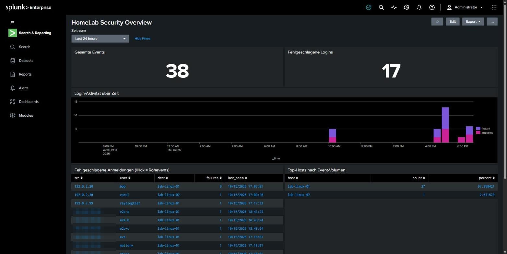
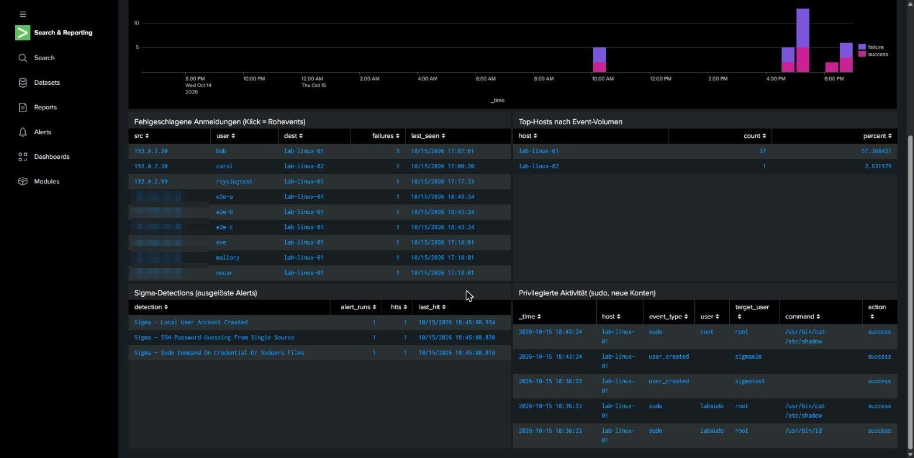
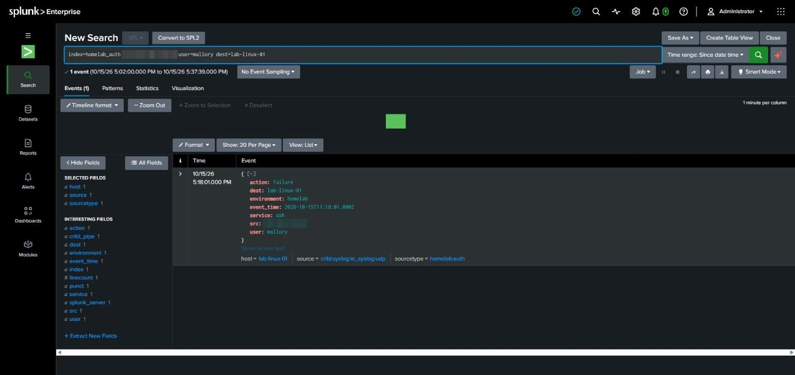
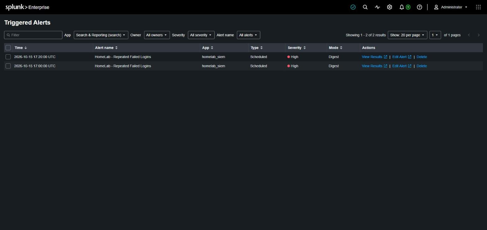
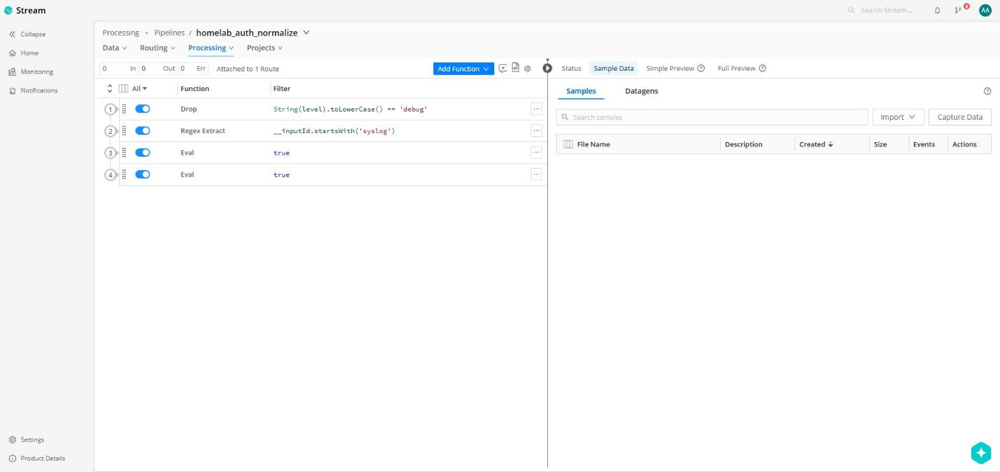
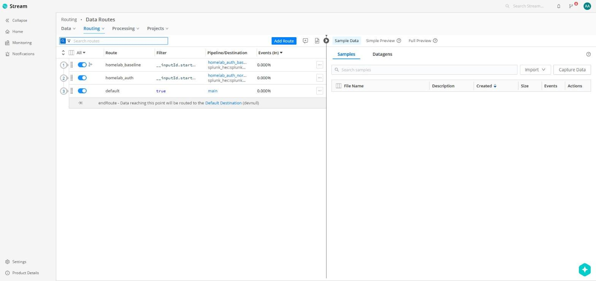

# Homelab SIEM: Cribl Stream und Splunk

[English version](README.en.md)

Ich wollte verstehen, was in einem SOC zwischen „jemand versucht sich per SSH anzumelden“ und „ein Analyst
sieht einen Alert“ eigentlich passiert. Also habe ich mir diese Kette in meinem Proxmox-Homelab selbst
aufgebaut: Linux-Hosts schicken ihre Auth-Logs per Syslog an Cribl Stream, Cribl bringt die Events in ein
einheitliches Format und gibt sie per HEC an Splunk weiter. In Splunk gibt es ein Dashboard mit Drilldown und
Alerts, die aus Sigma-Regeln erzeugt werden.

```
Testevents ───────HTTP :10080──┐
lab-linux-01 (sshd/rsyslog)    ├─▶ Cribl Stream ──HEC (intern)──▶ Splunk Enterprise
             ──Syslog UDP 9514─┘   homelab_auth_normalize          index=homelab_auth
                                   Debug verwerfen → sshd parsen → Dashboard · Alert · Drilldown
                                   normalisieren → JSON
```

Das Ganze läuft auf zwei VMs: `siem-docker` (VM 210, 4 vCPU, 8 GB, Docker) mit Cribl und Splunk und
`lab-linux-01` (VM 211, 1 vCPU, 1 GB) als echte Logquelle.





| Drilldown auf Rohevent | Ausgelöste Alerts | Cribl-Pipeline | Cribl-Routen |
|---|---|---|---|
|  |  |  |  |

## Warum so und nicht anders

- **Cribl vor Splunk:** Ich wollte die Daten normalisieren, bevor sie im Index landen, statt jede Suche um
  Feldvarianten herumzubauen. Egal ob ein Event `username`, `user_name` oder `user` mitbringt, in Splunk heißt
  das Feld immer `user`. Nebenbei lässt sich messen, wie viel Volumen eine Pipeline spart: Bei meinem
  Testdatensatz waren es 72,7 % weniger Bytes und 27,3 % weniger Events, ohne dass eine einzige
  fehlgeschlagene Anmeldung verloren ging ([Messung](docs/test-results.md#data-reduction)).
- **Fehler nie verwerfen:** Die Pipeline wirft nur Debug-Heartbeats weg. Ein Login-Fehler, der im Rauschfilter
  verschwindet, wäre genau der Fall, den man später sucht.
- **Konfiguration als Code:** Die Splunk-App (Index, `props.conf`, Dashboard, Alerts) liegt in
  [`splunk/homelab_siem`](splunk/homelab_siem/default), die Cribl-Konfiguration baut
  [`scripts/cribl-setup.py`](scripts/cribl-setup.py) über die API auf. So kann ich den Stack wegwerfen und
  wieder aufsetzen, ohne mich durch zwei Oberflächen zu klicken.
- **Detections als Sigma-Regeln:** Die Regeln sollen nicht an Splunk hängen. Im
  [Sigma Detection Lab](sigma-detection-lab/README.md) werden sie nach SPL übersetzt, gegen Testevents geprüft
  und in GitHub Actions validiert.
- **HEC nur intern:** Port 8088 ist nur im Docker-Netz erreichbar. Von außen kommt man nur über Cribl an Splunk.

## Aufsetzen

Die Befehle laufen auf der VM `siem-docker`, im Text steht dafür `<VM-IP>`.

```bash
# auf dem Proxmox-Host (oder ein vorhandenes Cloud-Init-Template klonen)
SSHKEY=/root/key.pub ./scripts/create-vm.sh
# auf der VM
curl -fsSL https://get.docker.com | sh
cp .env.example .env              # SPLUNK_PASSWORD und SPLUNK_HEC_TOKEN (uuidgen) setzen
docker compose up -d              # Splunk braucht ca. 2 Minuten bis "healthy"
set -a; . ./.env; set +a; python3 scripts/cribl-setup.py   # Source, Pipeline, Route, Destination
```

Cribl ist danach unter `http://<VM-IP>:9000` erreichbar (beim ersten Login das Standardpasswort ändern und in
`CRIBL_PASSWORD` eintragen), Splunk unter `http://<VM-IP>:8000` mit dem Passwort aus `.env`.

Als echte Quelle bekommt `lab-linux-01` rsyslog und die Zeile `auth,authpriv.* @<VM-IP>:9514` in
`/etc/rsyslog.d/90-cribl.conf`. Neue VMs richte ich inzwischen per Ansible ein, siehe
[homelab-infrastructure-automation](https://github.com/QuitScope/homelab-infrastructure-automation).

## Was die Pipeline normalisiert

| Regel | Umsetzung |
|---|---|
| `_time` aus `event_time` | `Date.parse(event_time) / 1000` |
| `user`, `src`, `dest` immer befüllt | `user‖username‖user_name`, `src‖src_ip‖rhost`, `dest‖host` |
| ein Vokabular für `action` | `failed/denied/error/invalid user → failure`, `accepted/ok/succeeded → success` |
| sshd-Syslog parsen | Regex auf `Failed …`, `Accepted …`, `Invalid user …` |
| Rauschen reduzieren | nur Events mit `level=debug` werden verworfen |

## Testen

```bash
./scripts/send-events.sh 3   # 3 Fehler in 5 Minuten, der Alert muss auslösen
./scripts/send-events.sh 2   # 2 Fehler, der Alert muss still bleiben
curl --data-binary @data/auth-events.jsonl http://<VM-IP>:10080/cribl/_bulk   # statischer Beispieldatensatz
python3 scripts/reduction-test.py 1000   # Data-Reduction-Messung (auf der VM, .env geladen)
```

Alle Ergebnisse mit den tatsächlichen Zahlen stehen in [docs/test-results.md](docs/test-results.md).

## Was schiefging und was ich daraus gelernt habe

- **`host` war in Splunk doppelt.** Splunk setzt `host` aus den Index-Metadaten und hat ihn zusätzlich aus dem
  JSON gezogen, das Feld war dadurch mehrwertig und Statistiken zählten falsch. Seitdem schreibt Cribl `host`
  nicht mehr ins `_raw`. Gelernt: Bei Splunk immer prüfen, welche Felder schon als Metadaten existieren.
- **sigma-cli war nicht so fertig, wie es aussah.** `convert -od` hat die Korrelationsregel über die Basisregel
  geschrieben, und das `savedsearches`-Format hat bei Korrelationen kaputte `.conf`-Dateien erzeugt. Ich
  konvertiere deshalb über die pySigma-API in einem eigenen Skript. Dazu kam, dass pySigma 2 nicht mit dem
  Splunk-Backend zusammenpasst, also ist 1.5.1 fest gepinnt.
- **Der erste CI-Lauf ist an Dateirechten gescheitert.** Unter Windows committete Skripte hatten kein
  Executable-Bit. Seitdem setze ich `git update-index --chmod=+x` und `.gitattributes` mit `eol=lf`.
- **Splunk Free kann keine Alerts.** Der Container läuft deshalb mit der 60-Tage-Testlizenz von Splunk
  Enterprise. Cribl Stream nutze ich in der kostenlosen Variante (bis 1 TB pro Tag).
- **Feste 5-Minuten-Fenster haben eine Lücke:** Ein Angriff, der genau über eine Fenstergrenze läuft, wird
  nicht erkannt. Für das Homelab reicht das, sauberer wäre ein gleitendes Fenster mit `streamstats`.
